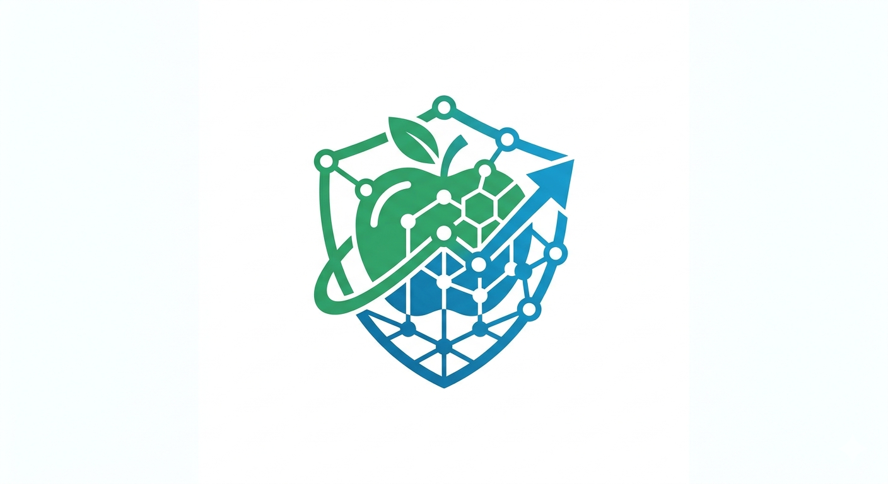
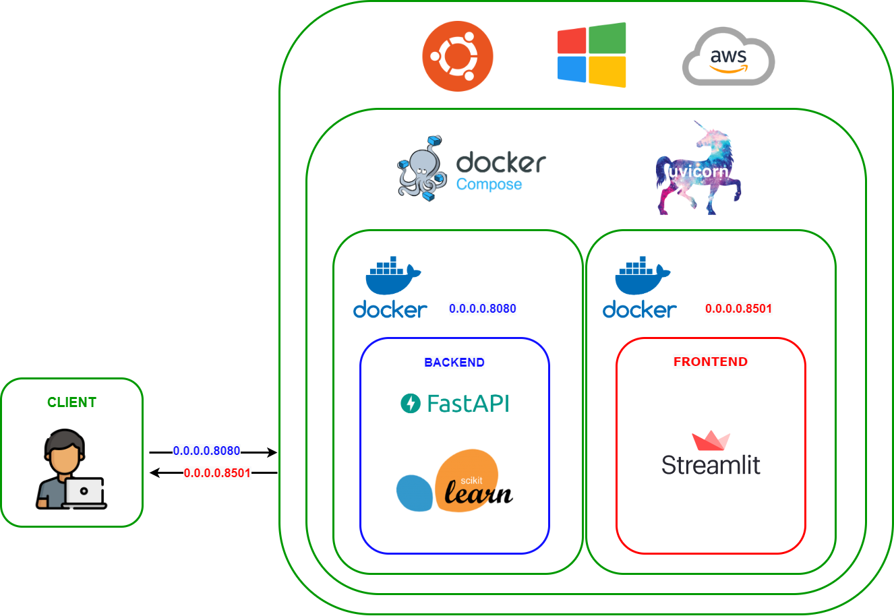

<div align="center">

[](https://github.com/zakaria-narjis/nutrimind/actions/workflows/ci.yml) [](https://zenodo.org/doi/10.5281/zenodo.12507163) [](https://github.com/astral-sh/ruff)

</div>

<h1 align="center">NutriMind</h1>
<div align="center">
  
  <h4>A personalized nutrition and recipe planner built with React, FastAPI, and Scikit-Learn.</h4>
</div>

---

## Table of Contents

- [Overview](#overview)
- [Architecture](#architecture)
- [How It Works](#how-it-works)
- [Tech Stack](#tech-stack)
- [Setup](#setup)
- [NutriPlan AI chatbot](#nutriplan-ai-chatbot)
- [API Reference](#api-reference)
- [Dataset](#dataset)
- [Citation](#citation)

---

## Star History

[](https://www.star-history.com/?repos=zakaria-narjis%2Fnutrimind&type=date&legend=top-left)

---

## Overview

A full-stack diet recommendation system that generates personalized meal plans based on user health data (age, weight, height, activity level) or custom nutritional targets. The recommendation engine uses a content-based approach with cosine similarity over nutritional vectors to find the closest matching recipes from a dataset of 500,000+ Food.com recipes.

**Key features:**
- Automatic meal plan generation from personal health metrics (BMI, BMR, TDEE)
- FoodSwap recipe comparison and local campus menu planning
- Custom food search by nutritional values and ingredients
- Configurable weight loss plans (maintain, mild, moderate, extreme)
- Interactive nutritional breakdown charts

---

## Architecture

<div align="center"></div>

---

## How It Works

### Recommendation Engine

Recipes are embedded as 9-dimensional nutritional vectors (Calories, Fat, Saturated Fat, Cholesterol, Sodium, Carbohydrates, Fiber, Sugar, Protein). A `NearestNeighbors` model with cosine similarity finds the closest recipes to a given target vector.

### Automatic Meal Plan (`/generate-meal-plan/`)

1. **BMI** — weight(kg) / height(m)²
2. **BMR** — Mifflin-St Jeor equation
3. **TDEE** — BMR × activity multiplier
4. **Target calories** — TDEE × weight-loss factor
5. Calories are distributed across meals (35/40/25% for 3 meals, etc.)
6. Per-meal nutrition vectors are sampled from physiologically appropriate ranges and passed to the nearest-neighbor model

### Ingredient Filtering

At startup, each recipe's ingredient list is pre-parsed into a `frozenset` of lowercase strings. Filtering then uses set-based substring matching — no regex scanning on every request.

### Content-Based Approach

| Advantage | Note |
|-----------|------|
| No cold-start problem | Works without any user history |
| Transparent recommendations | Results are directly tied to nutritional targets |
| No inter-user data needed | Fully self-contained per request |

---

## Tech Stack

| Component | Technology |
|-----------|-----------|
| Backend API | FastAPI 0.115, Python 3.12 |
| ML / Recommendation | scikit-learn 1.4 (NearestNeighbors, cosine) |
| Data processing | pandas 2.2, numpy 1.26 |
| Frontend | React 18, Vite 5, TypeScript |
| Legacy frontend | Streamlit 1.35, streamlit-echarts 0.4 |
| Containerization | Docker, Docker Compose |


---

## Setup

### Run locally on Windows

Install Python 3.12, Node.js 20, and (for local AI replies) Ollama. Open two PowerShell windows in the repository root.

In the first window, start the FastAPI backend:

```powershell
cd FastAPI_Backend
if (Test-Path .venv) { py -3.12 -m venv --upgrade .venv } else { py -3.12 -m venv .venv }
.\.venv\Scripts\python.exe -m pip install -r requirements.txt -r requirements-dev.txt
if (!(Test-Path ..\.env)) { Copy-Item ..\.env.example ..\.env }
.\.venv\Scripts\python.exe -m uvicorn main:app --reload --host 127.0.0.1 --port 8080
```

In the second window, start the React frontend:

```powershell
cd react_frontend
npm.cmd install
npm.cmd run dev -- --host 127.0.0.1 --port 5174
```

The API and deterministic recommendation features work without an AI credential. To enable local chatbot inference, install/start Ollama, then run `ollama pull qwen3:4b-instruct-2507-q4_K_M` in a separate PowerShell window. Keep `AI_PROVIDER=ollama` and `OLLAMA_MODEL=qwen3:4b-instruct-2507-q4_K_M` in the project-root `.env`. This non-thinking 4B model supports tool use; inference is local and response speed depends on hardware. Without Ollama or the selected model, the backend stays online and reports AI as unavailable; it does not fake an AI reply.

Open **http://localhost:5174**. The Vite dev server proxies API requests to FastAPI on port 8080. API docs are at **http://localhost:8080/docs**. PowerShell users can use `npm.cmd` if their execution policy blocks `npm.ps1`.

The backend loads `Data/dataset.csv` (about 95 MB) when it starts. For the original Streamlit frontend, install `Streamlit_Frontend/requirements.txt` and run `streamlit run Hello.py` from `Streamlit_Frontend`.

The backend loads configuration from its process environment and the project-root `.env` file. Existing process environment variables take precedence. Keep all backend secrets out of Vite environment variables. If a `.env` already exists, preserve it and edit only the settings you need. `OPENAI_API_KEY` is optional and is used only when `AI_PROVIDER=openai` is explicitly selected; it is never sent to the browser.

### Run with Docker Compose

Install [Docker Desktop](https://docs.docker.com/get-docker/) with Compose, then run from the repository root:

```powershell
docker compose up --build
```

Open **http://localhost**. Compose builds the React frontend and FastAPI backend; Nginx proxies the app's planner, recipe, FoodSwap, and chat API paths to FastAPI on the private Docker network. Only the frontend is published on the host. Check **http://localhost/health** for backend health through that proxy. Interactive API docs remain available at `http://127.0.0.1:8080/docs` in the separate local development setup above.

Compose reads the root `.env` for interpolation and passes server settings into the backend container. It stores API project configuration, hashed client keys, usage counters, and only explicitly opted-in API chat history in a local SQLite database volume/path. Keep `.env` private. Ollama is not bundled in this Compose stack; configure a private, reachable Ollama service with `OLLAMA_BASE_URL` if local inference is needed in containers. Do not publish an unauthenticated Ollama port to the internet. The Compose stack does not terminate HTTPS; a production host or reverse proxy must provide HTTPS. The existing GitHub Actions CD workflow builds and pushes container images; it does not provision or deploy a hosting service.

### Deploy to Render (separate React and FastAPI services)

Render can host the Vite build as a static site and FastAPI as a Python web service. Create both services from the same private Git repository. Keep the backend service's **Root Directory** at the repository root: FastAPI loads `Data/dataset.csv`, which is outside `FastAPI_Backend/`.

**FastAPI web service**

- Root Directory: repository root
- Python version: pinned by the root `.python-version`
- Build Command: `pip install -r FastAPI_Backend/requirements.txt`
- Start Command: `cd FastAPI_Backend && uvicorn main:app --host 0.0.0.0 --port $PORT`
- Health Check Path: `/health`
- Server environment: `AI_PROVIDER=ollama`, a privately reachable `OLLAMA_BASE_URL`, `OLLAMA_MODEL`, `API_ADMIN_TOKEN` (secret), a persistent disk for SQLite, and `CORS_ORIGINS` set to the exact HTTPS origin assigned to the frontend. A model running only on your laptop is not reachable from Render by default. Do not expose Ollama directly to the public internet. Alternatively, explicitly opt in to `AI_PROVIDER=openai` and configure `OPENAI_API_KEY` server-side.

**React static site**

- Root Directory: `react_frontend`
- Build Command: `npm ci && npm run build`
- Publish Directory: `dist`
- Build environment: `VITE_API_URL` set to the FastAPI service's HTTPS URL, such as `https://<your-api-service>.onrender.com`.

Set `VITE_API_URL` on the static site and `CORS_ORIGINS` on FastAPI after Render assigns the service URLs, then redeploy both. Never put API admin tokens, client keys, or `OPENAI_API_KEY` on the static site. Persist the backend SQLite directory across restarts or set up PostgreSQL before scaling beyond a single instance. Render's free web services can spin down after inactivity; choose an appropriate instance for continuous availability. See [Render's FastAPI guide](https://render.com/docs/deploy-fastapi), [Python version settings](https://render.com/docs/python-version), and [free-service limits](https://render.com/docs/free).

### Hosted Version

https://diet-recommendation-system.streamlit.app/

### Gym planner and recipe explorer

The React application also includes a Gym Diet Planner, Recipe Explorer, dashboard, saved plan, local recipe bookmarks, optional progress logging, and a shopping checklist. Open the Gym Planner to choose a goal, activity level, training schedule, diet preference, exclusions, and optional search preferences.

Adult energy values are estimates using the Mifflin–St Jeor resting-energy equation and an activity multiplier. Goal changes are limited to modest adjustments (−10% to +10%). Exercise protein guidance uses 1.4–2.0 g/kg/day for adults under 65; for adults 65+, the planner displays the commonly suggested 1.0–1.2 g/kg/day range. The chosen equation coefficient and macro arithmetic are shown with the results. Users under 18 and users who flag a need for individualized medical advice do not receive personalized targets. See the planner for the methodology and source links.

Saved plans, bookmarks, meal check-ins, meal logs, and optional weight logs are kept in browser local storage. Profile inputs are not saved. This is a local-device convenience, not encrypted or account-synced storage; avoid enabling progress logging on shared devices.

The recipe dataset includes recipe-level ingredients and nutrition values but no ingredient gram quantities, serving weights, recipe prices, or structured cuisine labels. Nutrition is presented as dataset-reported estimates, not lab-verified values. Portion scaling scales displayed nutrition only; cuisine searches match recipe text. The older recipe/Gym search budget field cannot price-filter because no price data is bundled; FoodSwap can apply a budget only to prices that you enter and source yourself. Vegetarian and vegan filters use ingredient keyword screening and should not replace checking labels for allergens or dietary requirements.

## NutriPlan AI chatbot

The React app includes a floating **NutriPlan AI – Your Personal Diet Assistant** chat panel. The frontend keeps the current conversation and profile in page memory and sends at most the latest 12 turns to FastAPI. Local Ollama inference is the default; the backend uses a narrow allow-list of tools backed by the existing recipe dataset, age-aware nutrition estimator, Gym Diet Plan engine, and FoodSwap service. External AI is disabled unless `AI_PROVIDER=openai` is explicitly configured. Plan generation creates a draft; a separate **Save to My Plan** action stores it in this browser. Add/replace recipe actions are separately validated by FastAPI and re-read nutrition from the dataset.

Configure the server-side settings in the project-root `.env` file (copy `.env.example` once, then edit it):

| Variable | Purpose | Default |
|---|---|---|
| `AI_PROVIDER` | `ollama` (default) or explicit external `openai` | `ollama` |
| `OLLAMA_BASE_URL` | Trusted local/private Ollama server URL | `http://127.0.0.1:11434` |
| `OLLAMA_MODEL` | Model installed in Ollama | `qwen3:4b-instruct-2507-q4_K_M` |
| `OLLAMA_TIMEOUT_SECONDS` | Local inference timeout | `600` |
| `OLLAMA_THINK` | Enable Qwen's extended thinking mode (slower on CPU) | `false` |
| `OLLAMA_MAX_OUTPUT_TOKENS` | Local model response-token cap | `512` |
| `OLLAMA_CONTEXT_LENGTH` | Context window for local chat and tool results | `8192` |
| `AI_MAX_OUTPUT_TOKENS` | Legacy alias for the OpenAI response-token limit | `1400` |
| `OPENAI_API_KEY` | Optional server-only key, used only with `AI_PROVIDER=openai` | unset |
| `OPENAI_MODEL` | Explicit OpenAI Responses model setting | `gpt-6-luna` |
| `OPENAI_TIMEOUT_SECONDS` | Provider request timeout (bounded by the backend) | `35` |
| `OPENAI_MAX_RETRIES` | SDK retries when external OpenAI is explicitly enabled | `1` |
| `OPENAI_MAX_OUTPUT_TOKENS` | Response output cap (bounded to 256–8192) | `1400` |
| `CHAT_RATE_LIMIT_PER_MINUTE` | Per-IP in-memory request limit | `12` |
| `API_ADMIN_TOKEN` | Private token required to create projects and client keys | unset |
| `NUTRIPLAN_DB_PATH` | SQLite database path | `FastAPI_Backend/data/api_platform.sqlite3` |
| `CORS_ORIGINS` | Comma-separated exact deployed frontend origins; local development origins are built in | blank |

The lightweight `GET /api/chat/health` check does not generate tokens. With Ollama it checks the local `/api/tags` endpoint and confirms the configured model is installed. It cannot guarantee future inference availability. The UI shows a connected state only after a successful readiness check; a real chat request is needed to confirm actual generation. Ollama does not send prompts to OpenAI/Gemini/Claude. If the model or server is absent, the chat displays a clear error and the deterministic APIs keep working.

Chat endpoints:

- `GET /api/chat/health` — provider/model configuration status; no credentials are returned.
- `POST /api/chat` — recent user/assistant turns and optional user-entered profile; returns an assistant message, dataset recipe cards, notes, and an optional generated plan draft.
- `POST /api/chat/plan-action` — validates a selected recipe against the dataset, diet, and exclusions before adding or replacing a meal and recalculating selected meal totals.
- Chat `compare_meals` — uses the same FoodSwap candidate filters and ranking logic; chat comparisons do not infer or rank by prices.

The existing browser chatbot keeps chat in page memory; the legacy `/api/chat` route does not persist messages. API platform clients use hashed project keys. Persistent API chat history is off by default and is saved only when a client sends `persist_history: true`; it can then be retrieved or deleted by that same client key. Admin/client metadata and non-content usage measurements are stored in SQLite. If external OpenAI is explicitly enabled, submitted messages/profile fields are sent to OpenAI under that account's data controls; this app does not promise zero retention. Browser plan data remains device-local and not encrypted. The rate limiter is process-local, so use shared infrastructure before multi-worker public deployment. Recipe filtering is conservative keyword screening and cannot guarantee allergy safety. Nutrition is dataset-reported per recipe serving; ingredient weights and verified quantities are unavailable.

The estimator uses Mifflin–St Jeor for adult resting-energy estimates and the existing activity multipliers. It presents ranges when requested, modest goal adjustments, and configurable protein rules: 1.4–2.0 g/kg/day for exercising adults under 65, 1.0–1.2 g/kg/day for adults 65+, and 0.8 g/kg/day when there is no regular training. These values are planning estimates, not medical measurements. Under-18 users and profiles flagged for individualized medical support receive safe guidance and no personalized target or gym plan. Pregnancy, eating-disorder concerns, kidney disease, and other medical needs should be handled with a qualified clinician or registered dietitian.

## Reusable API platform

The versioned REST API reuses the existing nutrition and recipe services rather than copying their data. OpenAPI is available at `/docs`; API v1 routes are under `/api/v1`. The local database uses Python's SQLite support, so it does not need a paid database service for one local instance. API keys are shown once, stored as salted PBKDF2 hashes, and can be revoked. A project can set its own name, enabled modules, request rate, and assistant instructions. Project chat is isolated by API client key; history is stored only when explicitly requested.

Core routes:

- `GET /api/v1/health/live`, `GET /api/v1/health/ready` — API and dataset/database health.
- `GET /api/v1/ai/status`, `GET /api/v1/ai/models` — Ollama/provider readiness and installed models.
- `POST /api/v1/projects` — create a project (requires `X-Admin-Token`).
- `POST /api/v1/projects/{project_id}/clients` — create a client and return its API key once (admin only).
- `GET /api/v1/projects/me`, `GET /api/v1/projects/me/usage` — authenticated project identity and actual request counters.
- `POST /api/v1/chat` — local-model chat with an optional `persist_history: true` consent field.
- `GET/DELETE /api/v1/chat/history/{conversation_id}` — read or clear only the authenticated client's saved conversation.
- `GET /api/v1/recipes`, `GET /api/v1/recipes/{recipe_id}` — dataset-backed recipe search/details.
- `POST /api/v1/nutrition/calculate`, `/api/v1/nutrition/daily-requirements`, `/api/v1/nutrition/meal-plan`, `/api/v1/nutrition/analyze-meal` — existing safe estimator, planner, and dataset arithmetic.

If `API_ADMIN_TOKEN` is blank, generate a private local admin token in PowerShell. This updates only the ignored root `.env`; it never prints the token:

```powershell
$adminToken = [Convert]::ToBase64String([Security.Cryptography.RandomNumberGenerator]::GetBytes(32))
$lines = Get-Content -LiteralPath .env
$found = $false
$lines = $lines | ForEach-Object { if ($_ -match '^API_ADMIN_TOKEN=') { $found = $true; if ($_ -eq 'API_ADMIN_TOKEN=') { 'API_ADMIN_TOKEN=' + $adminToken } else { $_ } } else { $_ } }
if (!$found) { $lines += "API_ADMIN_TOKEN=$adminToken" }
Set-Content -LiteralPath .env -Value $lines -Encoding utf8
Remove-Variable adminToken
```

Restart FastAPI after changing `.env`. To create a future project and a client key, run this from the repository root after starting the backend; it prints the generated client key once to your local PowerShell session. Do not paste it into chat or put it in browser code:

```powershell
$adminToken = ((Get-Content -LiteralPath .env | Where-Object { $_ -match '^API_ADMIN_TOKEN=' } | Select-Object -Last 1) -replace '^API_ADMIN_TOKEN=', '')
$adminHeaders = @{ 'X-Admin-Token' = $adminToken }
$project = Invoke-RestMethod -Uri 'http://127.0.0.1:8080/api/v1/projects' -Method Post -Headers $adminHeaders -ContentType 'application/json' -Body '{"project_id":"studymate","name":"StudyMate","description":"A second app","system_prompt":"Explain study topics clearly.","enabled_modules":["chat"],"rate_limit_per_minute":30}'
$client = Invoke-RestMethod -Uri 'http://127.0.0.1:8080/api/v1/projects/studymate/clients' -Method Post -Headers $adminHeaders -ContentType 'application/json' -Body '{"name":"StudyMate server"}'
$client.api_key
Remove-Variable adminToken,adminHeaders
```

The included TypeScript SDK is in `sdk/typescript`; it is intended for trusted server-side callers. A browser frontend should call its own trusted backend rather than embed a private key.

Install Ollama and download a model suited to the machine. A small quantized model needs several GB of memory and is slower on CPU; larger models require more RAM/VRAM. `qwen3:4b-instruct-2507-q4_K_M` is the project default and must still be installed explicitly with `ollama pull qwen3:4b-instruct-2507-q4_K_M`. The original `qwen3:4b` tag is a thinking model and can be much slower on CPU. Some models vary in tool-calling quality. There is no model bundled in Git, and the app reports unavailable until the model exists. The supplied recipe data is not an ingredient nutrient database, so no invented food micronutrient endpoint is exposed.

This foundation does not yet provide JWT user accounts, PostgreSQL/Alembic migrations, a browser-based API management dashboard, model downloads/management, production-grade distributed rate limiting, or real token-by-token streaming. SQLite and local rate limits are suitable for development/single-instance evaluation, not a horizontally scaled public service. See the API schema for current request/response contracts; do not treat the current setup as audited production security.

### Fix My Plate, kitchen search, and meal logs

- **Fix My Plate** (`/fix-my-plate`) searches the bundled recipe data using a dish or ingredient term. Users select recipes and explicit serving multipliers; FastAPI validates recipe IDs and calculates the combined dataset totals at `POST /api/meal-plate/calculate`. A free-text note is kept only as context and is not assigned guessed nutrition values.
- **What’s in My Kitchen?** (`/kitchen`) searches each user-confirmed ingredient, ranks recipes by matching ingredient text, and lists entered names not found in each recipe. It does not recognize pantry photos, infer ingredient quantities, or verify what is actually in stock.
- **Recipe Explorer** includes mood presets and a **Surprise My Plate** picker. The picker selects among recipes returned by the current filters; reroll requests another eligible result. Mood labels are discovery shortcuts, not health classifications.
- The Explorer has a small preference quiz that turns the user's answers into real recipe filters. **Cook with me** shows recorded recipe instructions one step at a time and has optional user-set timers; it does not infer per-step cooking times.
- Recipe cards provide a safely encoded YouTube search link. It is explicitly a search page, not a verified individual tutorial. No YouTube API key is required or configured.
- Recipe cards can be logged on this device, saved, and shared as downloadable SVG meal cards. **My Diet Plan** includes a seven-day recap, custom meal-name entries, status changes, and editable logged recipe servings. A custom entry without recipe data contributes no nutrition to the recap.
- **Meal Prep Buddy** builds a local queue from chosen saved-plan meals, shows ingredient names and the sum of recorded recipe times, and makes no batch-overlap or quantity estimates. The optional one-meal challenge and earned check-in badge are based on local recipe-backed meal logs. The header toggle enables the existing dark color tokens.

Recipe search, Fix My Plate, kitchen search, and Gym Planner default to **Any recipe / no diet filter**; users can select vegetarian without eggs, egg-inclusive vegetarian, or vegan explicitly. Allergy and exclusion fields are optional and use conservative text screening, so users still need to inspect labels.

### FoodSwap AI and Campus Intelligence

The **FoodSwap** page (`/foodswap`) compares selected dataset recipes with alternatives that pass the selected diet, exclusions, protein, calorie, and preparation constraints. Its bounded candidate shortlist and score weights are returned in API notes. The balanced score uses dataset protein (35%), ingredient-text matches (25% when provided), calorie similarity (20%), and prep time (20%); the selected priority changes those weights. Missing score dimensions are omitted and remaining weights are rescaled. For a lower-cost request without alternative prices, the balanced score is used and disclosed. Prices are never estimated: a user can provide a per-recorded-serving price, source, and date; those request-scoped values are not retained by FastAPI. Budget limits exclude known over-budget alternatives while unpriced options remain marked unknown. Candidate nutrition comes from the bundled Food.com dataset per recorded serving; gram weights are unavailable. Diet and exclusion screening is keyword-based and is not an allergy safety guarantee.

Selecting an alternative creates a temporary draft in browser local storage. **My Plan** requires a separate confirmation before adding the recipe to the locally saved plan, and FastAPI revalidates the selection and calculates from its dataset row. Ranking alone does not change a saved plan.

The **Campus** page (`/campus`) supports manually entered daily mess/PG menus, dataset-backed recipe choices, serving multipliers, user-entered prices with source/date, per-week spending totals, recurring local templates, and ingredient-name grocery checklists. Custom menu items keep nutrition unavailable. Only supplied costs contribute to the known spending total; if any costs are unknown the budget state is marked partially unknown. Menu data, templates, and weekly budgets remain in this browser. The project has no authoritative hostel food-composition table, verified local prices, menu-photo OCR, portion weights, or ingredient quantities. Future photo extraction would need user verification before saving a menu item.

The meal plate endpoint accepts 1–20 dataset recipe IDs with serving multipliers from 0.25 to 3 and returns summed calories, protein, carbohydrate, and fat. These remain recipe-level estimates. The existing dataset contains no gram weights or serving sizes that can map a hostel mess portion to a recipe, no ingredient-level nutrition, and no local price data. Therefore, free-text mess meals and budgets cannot be accurately analyzed or price-ranked. The user must select a dataset recipe that they consider representative; do not treat the result as a measurement of an unstructured meal.

YouTube search URLs are generated from recipe names through URL encoding and open the fixed `youtube.com` search domain in a new tab. Individual result relevance and availability are not checked. The optional official YouTube Data API integration is not configured.

This upgrade does not include a verified Indian food-composition catalog for standalone foods such as one roti or a bowl of dal, current local prices, pantry-photo recognition, food-expiry tracking, an evaluation dashboard (the project has no authentication/authorization system), or verified individual YouTube tutorial metadata. Recipe tutorials use a labeled YouTube search fallback. Meal logs, campus menus, templates, budgets, and saved plans remain browser-local; there is no account, cross-device sync, or permanent server-side meal history. The weekly recap is based only on locally logged entries, and share cards omit private profile data.

To run checks from the project root:

```powershell
cd FastAPI_Backend
.\.venv\Scripts\python.exe -m pytest tests -q
.\.venv\Scripts\ruff.exe check .
cd ..\react_frontend
npm.cmd test
npm.cmd run lint
npm.cmd exec -- tsc --noEmit
npm.cmd run build
```

Backend chat tests mock the OpenAI SDK, so the suite does not require a paid API call. The actual live conversational provider requires a valid server-side key.

---

## API Reference

Interactive docs are available at **http://localhost:8080/docs** when the backend is running.

### Added planner endpoints

- `GET /health` — explicit health alias; `GET /` remains supported.
- `POST /nutrition/calculate` — returns age-aware, explainable estimates without recipes.
- `POST /gym-diet-plan` — returns estimates and diet-filtered meal, pre-workout, and post-workout suggestions.
- `GET /recipes` — paginated filters for diet preference, category, calories, protein, protein per 100 calories, time, ingredient inclusion/exclusion, and text/cuisine search. A `portion_multiplier` scales displayed nutrition values.
- `GET /recipes/{recipe_id}` — returns one bundled recipe record with optional nutrition scaling.
- `POST /api/meal-plate/calculate` — validates selected recipe IDs and 0.25–3 serving multipliers, then returns totals sourced from those recipe records.
- `POST /api/foodswap/compare` — filters and ranks dataset recipes using FoodSwap constraints, request-scoped user prices, and source notes.

Example Gym Diet Planner request:

```json
{
  "age": 30,
  "height": 175,
  "weight": 70,
  "sex_coefficient": "range",
  "activity": "Moderate exercise (3-5 days/wk)",
  "training_days": 4,
  "training_experience": "intermediate",
  "goal": "lean_gain",
  "dietary_preference": "vegetarian",
  "allergies": ["peanut"],
  "disliked_foods": [],
  "meals_per_day": 4,
  "workout_time": "evening",
  "professional_support_needed": false
}
```

`sex_coefficient` accepts `male`, `female`, or `range`. `goal` accepts `lean_gain`, `bulk`, `fat_loss`, and `maintenance`. Diet values are `vegetarian`, `egg-inclusive`, `vegan`, and `omnivore`.

### `POST /generate-meal-plan/`

Generates a full daily meal plan from personal health data.

**Request body:**
```json
{
  "age": 28,
  "height": 175,
  "weight": 70,
  "gender": "Male",
  "activity": "Moderate exercise (3-5 days/wk)",
  "number_of_meals": 3,
  "weight_loss": "Maintain weight"
}
```

**Response:** BMI, BMR, daily calorie targets, and recommended recipes per meal.

### `POST /predict/`

Finds recipes matching a custom 9-value nutrition vector with optional ingredient filtering.

**Request body:**
```json
{
  "nutrition_input": [500, 20, 3, 50, 800, 60, 8, 5, 30],
  "ingredients": ["chicken", "garlic"],
  "params": {"n_neighbors": 5, "return_distance": false}
}
```

---

## Dataset

Food.com recipes dataset — 500,000+ recipes from [Kaggle](https://www.kaggle.com/datasets/irkaal/foodcom-recipes-and-reviews?select=recipes.csv).

---

## Citation

```bibtex
@software{narjis_2024_12507829,
  author       = {Narjis, Zakaria},
  title        = {Diet recommendation system},
  month        = jun,
  year         = 2024,
  publisher    = {Zenodo},
  version      = {v1.0.1},
  doi          = {10.5281/zenodo.12507829},
  url          = {https://doi.org/10.5281/zenodo.12507829}
}
```
